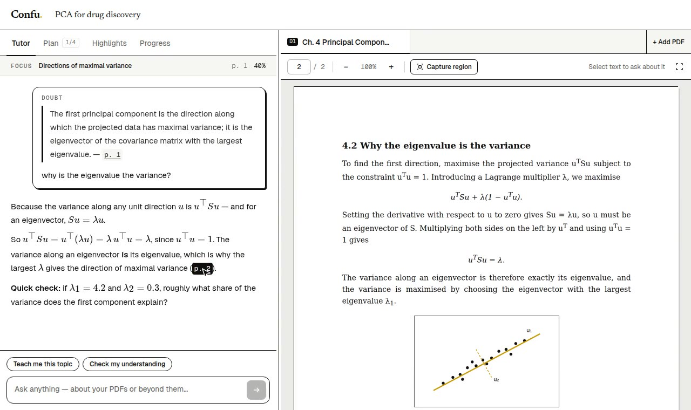

<p align="center">
  
</p>

<h1 align="center">Confu</h1>

<p align="center">
  A free, open-source AI tutor that works from your own notes, textbooks and papers.<br />
  It plans what to learn, answers the line you highlight, and remembers your progress.
</p>

<p align="center">
  <a href="https://confu.lol"></a>
  &nbsp;&nbsp;
  <a href="#see-it"></a>
  &nbsp;&nbsp;
  <a href="LICENSE"></a>
</p>

<p align="center">
  <sub>Anyone may use it, change it, and share it, including to run it for a class or a campus. <code>private</code> in <code>package.json</code> only keeps this app off the npm registry. The fonts in <code>public/fonts</code> stay under the SIL Open Font License (<code>public/fonts/OFL.txt</code>).</sub>
</p>

## See it

The real workspace, then the three short films from the site. Click a still to play.

<p align="center">
  <a href="public/demo/confu-demo.mp4">
    
  </a>
</p>

<p align="center"><sub>Highlight a line. Ask. The answer cites the page, and the page opens.</sub></p>

<table>
  <tr>
    <td align="center" width="33%">
      <a href="public/reels/stop-highlighting.mp4"></a>
      <br /><b>Stop highlighting</b>
      <br /><sub>Asking beats rereading.</sub>
    </td>
    <td align="center" width="33%">
      <a href="public/reels/start.mp4"></a>
      <br /><b>Know where to start</b>
      <br /><sub>A goal becomes a plan.</sub>
    </td>
    <td align="center" width="33%">
      <a href="public/reels/forget.mp4"></a>
      <br /><b>Forget less</b>
      <br /><sub>Finished topics come back.</sub>
    </td>
  </tr>
</table>

## Setup

1. `bun install`
2. Copy `.env.example` to `.env.local` and fill it in.
3. In the Supabase SQL editor, run [`supabase/schema.sql`](supabase/schema.sql) once, on an empty project. That file is the whole database: tables, row level security, functions, the private `documents` bucket, and the subject spaces. [`supabase/README.md`](supabase/README.md) explains it. Do not run it on a database that already has Confu tables.
4. In Supabase, go to **Authentication → URL Configuration**. Set the Site URL to `http://localhost:3000` and add `http://localhost:3000/auth/confirm` to Redirect URLs (and the same for your production domain).
5. For real users, set up custom SMTP in **Authentication → Emails**. Supabase's built-in sender is heavily rate-limited, and sign-up confirmation, password reset and email change all send mail.
6. `bun dev`

## Bring your own AI

Confu is free and open source, with no plans or payments. Each account brings its own AI, in **Settings → Your AI** (or the panel a session shows when nothing is connected):

- **Connect OpenRouter**: one click. The student approves Confu on openrouter.ai (OAuth with PKCE) and Confu receives a key of their own, billed to their OpenRouter credits.
- **An API key** from Groq, OpenAI, Anthropic, Google Gemini, OpenRouter, or any OpenAI-compatible server (Ollama, LM Studio, vLLM, DeepSeek, Mistral…). Keys are checked with the provider, then encrypted with `KEY_ENCRYPTION_SECRET` (AES-256-GCM) before they're stored.

Confu picks a model for each job from the provider's live model list (tutor, progress notes, figures and scans); students can change them. A session can have its own key that overrides the account's.

Anthropic goes through the official Anthropic SDK (Messages API); every other provider goes through its OpenAI-compatible chat API. Both sit behind one client, so the rest of the code doesn't know which provider it's talking to (`lib/ai/`).

### The server's own keys (optional)

`GROQ_API_KEYS` are used for two things only:

| Who | What runs on the server's keys |
| --- | --- |
| The owner (`profiles.role = 'admin'`) | Their own AI, if they connected one, runs first. These keys answer when that provider can't (rate limit, no credit, a missing model, or it is down). With no key of their own, everything runs here. The admin dashboard is theirs either way. |
| Everyone else | 10 free prompts (and 20 scanned pages), once, so they can try Confu before connecting anything. The counts live on the profile. |

Leave `GROQ_API_KEYS` empty to turn both off: then everyone, the owner included, connects their own AI. Make yourself the owner once, in the SQL editor:

```sql
update public.profiles set role = 'admin'
where id = (select id from auth.users where email = 'you@example.com');
```

### Running it yourself with a local model

Point "Other (OpenAI-compatible)" at your model server, e.g. `http://localhost:11434/v1` for Ollama. A server on your own network is blocked by default, so a shared deployment can't be made to fetch internal addresses. Set `ALLOW_PRIVATE_AI_URLS=1` on a server only you use.

## How it works

| Piece | Where |
| --- | --- |
| Auth: email/password, confirmation, password reset | `app/(auth)`, `app/auth/confirm`, `proxy.ts`, `lib/dal.ts` |
| Library and new sessions (study, exam prep, papers; you always name them) | `app/dashboard`, `components/dashboard` |
| Sessions: one goal, many PDFs (tabs D1, D2, …), editable title | `app/session/[id]`, `components/workspace/DocTabs.tsx`, `SessionTitle.tsx` |
| Upload: text and outline extracted in the browser, indexed per page | `lib/pdf/upload.ts`, `lib/pdf/extract.ts` |
| Plan: goal + deadline → phased topics across all PDFs and beyond them | `app/api/plan`, `lib/tutor/plan.ts`, `lib/schedule.ts` |
| Tutor: retrieval (Postgres full-text) + goal + plan + memory → streamed answer | `app/api/chat`, `lib/tutor/context.ts`, `lib/tutor/prompts.ts` |
| Memory: updated after each exchange, feeds every prompt and topic mastery | `lib/tutor/memory.ts` |
| Figures: captured region → vision model notes → stored as context | `app/api/figure`, `components/pdf/PdfViewer.tsx` |
| Exam prep: questions from your notes, strict marking, weak topics | `app/api/exam`, `lib/tutor/exam-ai.ts`, `components/exam` |
| Papers: arXiv/DOI lookup, triage, Keshav's three passes, literature search | `app/api/paper`, `lib/scholar.ts`, `lib/tutor/paper-*.ts`, `components/paper` |
| Your AI: providers, models, the request adapters, OpenRouter connect | `lib/ai/`, `lib/ai-access.ts`, `lib/ai-keys.ts`, `app/api/ai/openrouter`, `components/keys` |
| The server's keys (owner, free prompts), with failover across keys | `lib/groq-pool.ts` |
| Usage meter: tokens per key and model, rate limits where reported, freshness | `lib/usage.ts`, `lib/usage-summary.ts`, `lib/usage-probe.ts` |
| Settings: profile, security, your AI, usage, export, delete account | `app/settings`, `components/settings`, `app/api/export` |

Models on the server's keys (Groq): `openai/gpt-oss-120b` (tutor, planner, marking), `openai/gpt-oss-20b` (memory), `qwen/qwen3.8-27b` (vision). Override them with the `GROQ_*_MODEL` env vars; they're also the defaults for students' Groq keys.
